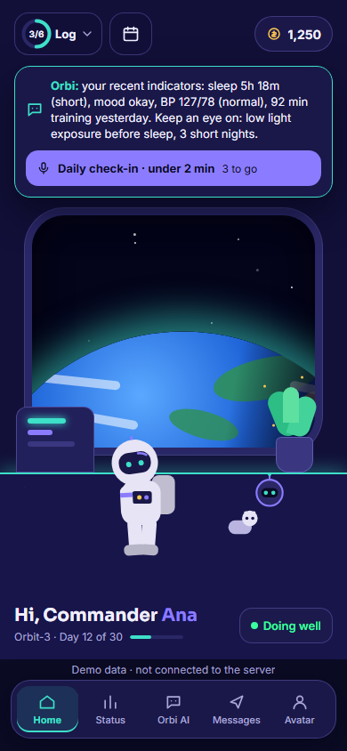
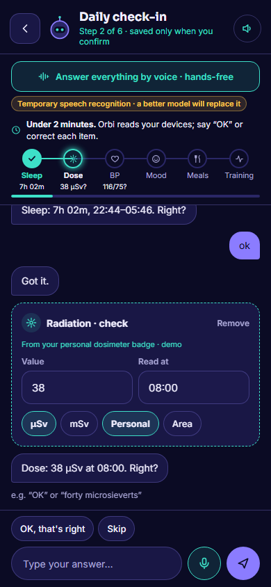
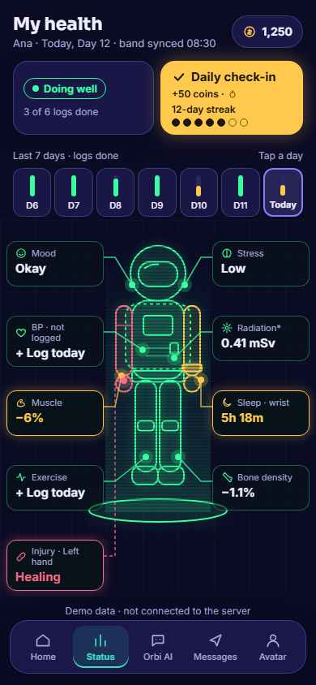
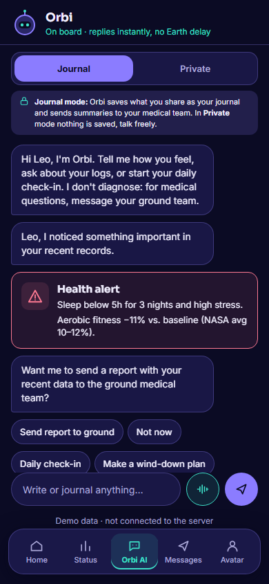
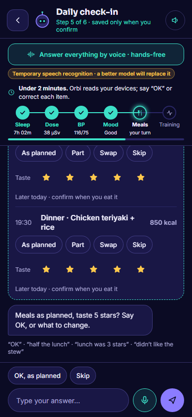
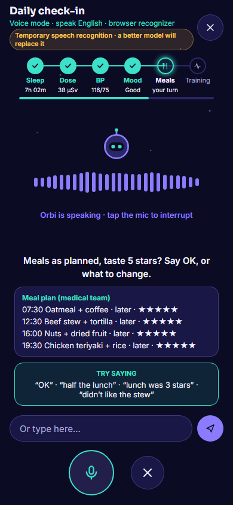
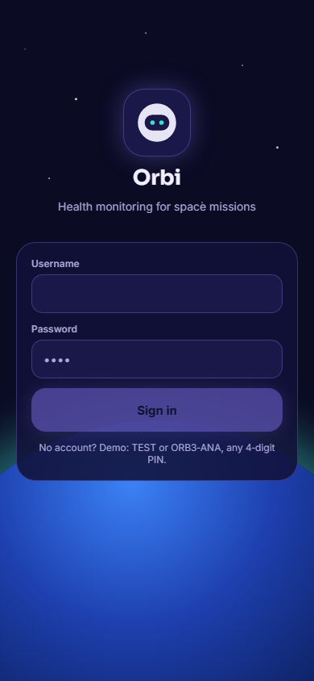
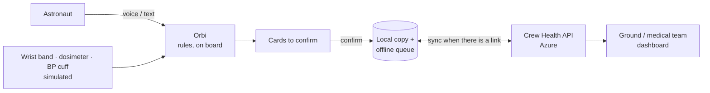

<div align="center">


# Orbi

**Your on-board health companion: a daily health check-in in under two minutes, made for life far from Earth.**

NASA Space Apps Challenge 2026 · *Create Health Monitoring Software for Astronauts on Space Missions*

**[▶ Open the live app](https://nasa-space-apps-2026-front-end-murex.vercel.app)** · demo login: `TEST` or `ORB3-ANA`, any 4-digit PIN

</div>

<p align="center">
  
  
  
  
</p>

## The problem

On a long mission, astronauts deal with radiation, isolation, altered gravity and a closed environment, while their days are packed to the minute. Their health data is spread over several devices and forms. Help from Earth arrives with a communication delay, and on missions beyond the Moon it can take many minutes each way.

Health logging has to be **fast**, it has to **work without a link to Earth**, and it should turn the data into something the astronaut and the medical team can act on.

## The solution

**Orbi** is a mobile app (phone and web) with an on-board assistant, also called Orbi:

- **Daily check-in in under 2 minutes.** Orbi reads the devices first: sleep from the wrist band, dose from the personal dosimeter, blood pressure from the cuff. It also loads today's meal and training plan. Then it goes through one item at a time, and the astronaut says **"OK"** or corrects the value ("slept six hours", "120 over 80, pulse 70"). This works by voice or text, or fully hands-free in voice mode. Nothing is saved until the astronaut confirms.
- **Meal and training plans instead of forms.** The medical team's plan is already filled in. Each meal is confirmed as planned, part, swapped or skipped, with a 5-star taste rating to catch *menu fatigue*. Training sessions come from the schedule.
- **My health at a glance.** Eight indicators on a body hologram: mood, stress, blood pressure, radiation, muscle, sleep, exercise and bone density, compared with the pre-flight baseline. The app shows a status tag ("Doing well", "Attention", "Alert") instead of a score.
- **Insights and alerts.** Orbi summarizes the recent indicators on Home and adds a short insight to Sleep, Mood, Body and Meals. Critical alerts appear in the chat with **"Send report to ground"**, an urgent message with the evidence logs attached.
- **Messages that respect the delay.** Each message shows when it arrives on Earth. "Request medical support" guides a structured request, and it can be dictated.
- **Journal and Private.** In Journal mode, conversations with Orbi feed the journal the medical team sees. In Private mode nothing is stored.
- **Works offline.** Every change is saved on the device first and synchronized when the link comes back.
- **Motivation without pressure.** Coins, an avatar (Bolt) with a shop, and **private** achievements, with no crew ranking of health data.

<p align="center">
  
  
  
</p>

## How Orbi answers the challenge

| Hazard (NASA HRP) | What Orbi does |
|---|---|
| **Space radiation** | Daily personal dose from the dosimeter badge, the mission total, and the area dose rate (the room, not the body). NASA sets no fixed limit for long missions, so values are shown as illustrative and are not coloured as safe or unsafe. |
| **Isolation and confinement** | Quick mood check-in with tags (homesick, lonely, anxious…), a Journal shared with the medical team, a Private mode, and alerts for several low-mood days. |
| **Distance from Earth** | Orbi runs on board and replies with no Earth delay. The app is offline-first. Messages show the arrival time on Earth, and alerts are packed into one report for the ground team. |
| **Gravity fields** | Bone density, strength and aerobic fitness compared with the pre-flight baseline (HRP averages as reference). The training plan uses the station equipment: ARED, cycle and treadmill. |
| **Hostile and closed environments** | Sleep with light exposure and cabin noise from the band (crews see 16 sunrises a day), an area radiation monitor, and a meal plan to keep calories on target and avoid menu fatigue. |

## Safety and responsible design

- **Orbi does not diagnose.** It reads data, explains it and points to the medical team.
- **Confirm before save.** Every value read or guessed by Orbi is shown to the astronaut, who can correct it.
- **Private means private.** Private conversations never leave the device and never enter the sync queue.
- **Honest labels.** Simulated devices are marked *demo*, missing days show as "no data" (never as 0), and radiation values are marked illustrative.
- **No ranking of health.** Achievements are personal. Nobody is compared with the crew.

## Orbi today and next

**Today, Orbi is rule-based, not an AI model**, so it works on board, offline and predictably:

1. **Speech → text:** the phone or browser recognizer, or an on-device model (Moonshine via transformers.js) when the browser has none. Audio never leaves the device.
2. **Text → action by rules:** `src/data/orbiParser.ts` reads numbers (in digits or words), clock times, durations and keywords. Whatever it cannot read is marked "Orbi guessed" for the astronaut to check.

**Next:** a language model behind the same two interfaces (`OrbiFillParser` and the backend's `/app/me/orbi/chat`), so the screens do not change. It must run on board as a small local model, or tolerate the Earth delay. The "confirm before save" and "Private stores nothing" guarantees stay.

## Try it

**Live:** https://nasa-space-apps-2026-front-end-murex.vercel.app

| Demo Crew ID (any 4-digit PIN) | What to look at |
|---|---|
| `TEST` | Nothing logged yet: run the whole **daily check-in** (and spend 999,999 coins in the shop). |
| `ORB3-ANA` | A typical astronaut: short sleep after low light exposure. |
| `ORB3-LEO` | **Critical alert** in Orbi AI (short sleep, high stress, fitness drop) and a knee injury. |
| `ORB3-MIKA` | Low mood and menu fatigue. |
| `ORB3-RAJ` | Steady, everything in range. |

The app signs in on the real backend (Crew Health API on Azure). The demo Crew IDs fall back to built-in demo data when the server does not know them, shown by the "Demo data · not connected to the server" line. Real accounts never fall back.

## Architecture



- **App:** React Native + Expo SDK 58 (one codebase for Android, iOS and web), Expo Router, TypeScript.
- **Data:** a reactive local copy of the server snapshot. Writes go to an offline queue with one operation ID each, so every change is applied once.
- **Voice:** `expo-speech` (Orbi speaks), the system or browser recognizer, Moonshine on-device as fallback, and `expo-audio` for mood voice notes.
- **Backend:** Crew Health API (separate repository), with username/password login, a snapshot and sync.

## Run locally

```bash
npm install
npm run web          # browser, phone-width frame
npx expo start       # Expo Go / emulator
```

By default the app uses the deployed backend. To use only the demo data, create `.env.local`:

```dotenv
EXPO_PUBLIC_USE_MOCK_DATA=true
```

Checks:

```bash
npm test             # HTTP, sync and offline-queue tests (no real API calls)
npx tsc --noEmit
npx expo lint
```

## Project structure

| Path | What |
|---|---|
| `src/app/` | Screens (Expo Router): login, onboarding, tabs, logs, daily check-in, ground dashboard |
| `src/components/` | Shared UI, built on the design tokens |
| `src/data/` | Data API, sync and offline queue, Orbi's parser, plans, derived values |
| `src/voice/` | Speech recognition and text-to-speech |
| `src/avatar/` | Bolt's animation state machine |
| `src/mocks/` | Demo data |
| `docs/design/` | Design handoff: screens, components, data model, tokens, animations, build log |

## Known limitations

- Devices (wrist band, dosimeter, BP cuff) are **simulated**. Pairing is recorded in the backend, with no Bluetooth yet.
- Meal and training plans and the insights are demo data until the API provides them.
- Speech recognition in the browser is temporary, and a better on-device model is planned.
- Injury photos, the calendar and relaxation content are still prototypes.

## Sources

From the challenge page and the resources it links:

- **Space Apps Challenge 2026:** *Create Health Monitoring Software for Astronauts on Space Missions*.
- **NASA Human Research Program (HRP):**
  - Hazards: Space Radiation, Isolation and Confinement, Distance from Earth, Gravity Fields, Hostile and Closed Environments;
  - HRP Risks and Ongoing HRP Research;
  - ARCHeR (Artemis II);
  - Standard Measures;
  - the sleep, behavioral health, nutrition, fitness and bone loss risks;
  - NASA's space radiation page;
  - the HERA article on communication delay.
- **Canadian Space Agency (CSA):**
  - *Monitoring radiation and astronaut health*;
  - *Why do we conduct science experiments in space?*;
  - the infographic on the effects of space on the body.

## License

[MIT](LICENSE)
